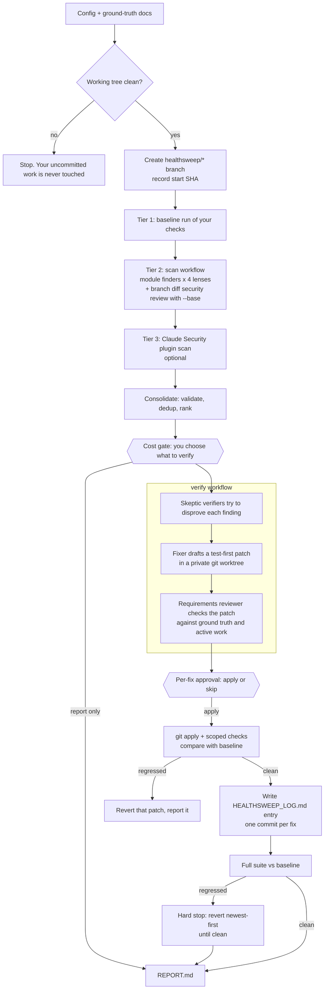

<div align="center">

<picture>
  <source media="(prefers-color-scheme: dark)" srcset="assets/banner-dark.svg">
  <source media="(prefers-color-scheme: light)" srcset="assets/banner-light.svg">
  
</picture>

<p><strong>An agent skill that audits a codebase for bugs, security holes and latency problems, has every finding re-checked by an independent agent, and applies only the fixes you approve, each with an evidence log entry.</strong></p>

<p>Works with <b>Claude Code</b> · <b>Codex CLI</b> · <b>Cursor</b> · <b>Gemini CLI</b> · <b>GitHub Copilot</b> · <b>OpenCode</b> · any agent that reads <a href="https://agentskills.io">Agent Skills</a></p>

<p>
  <a href="LICENSE"></a>
  <a href="https://github.com/RohitBind123/claude-healthsweep-/releases"></a>
  <a href="https://www.npmjs.com/package/healthsweep"></a>
  <a href="https://github.com/RohitBind123/claude-healthsweep-/actions/workflows/ci.yml"></a>
  <a href="https://github.com/RohitBind123/claude-healthsweep-/stargazers"></a>
  <a href="https://docs.claude.com/en/docs/claude-code/plugins"></a>
  <a href="https://agentskills.io"></a>
  <a href="package.json"></a>
</p>

</div>

<p align="center"></p>

<p align="center"><em>The demo runs the deterministic engine on a toy repo; the finder output is sample data, in a real run agents produce it.</em></p>

## Why

The bugs that hurt most in production are rarely the ones a linter or a unit test catches. Two
requests overlap and the slower one wins. A value is saved in one place and recomputed in another,
and nothing checks that the two still agree. Tests pass, code review passes, and the defect ships.
healthsweep is built to catch that class of bug earlier: one finder looks only at concurrency and
data consistency, and a separate agent that did not write the finding has to reproduce it before
anyone drafts a fix.

## Quickstart

### Claude Code (full experience: workflows + Tier 3)

```text
/plugin marketplace add RohitBind123/claude-healthsweep-
/plugin install healthsweep@healthsweep
```

Restart Claude Code (`claude --resume` keeps your conversation) so the skill and workflows load. In
testing, `/reload-plugins` did not always pick up a plugin installed mid-session.

### Codex, Cursor, Gemini CLI, GitHub Copilot, OpenCode

```bash
npx healthsweep@0.2.1 install --agent codex   # or cursor, gemini, copilot, opencode
npx healthsweep@0.2.1 install --all           # every agent at once
```

This copies the self-contained skill folder to where your agent looks (`~/.agents/skills`,
`~/.cursor/skills`, `~/.gemini/skills`, ...). Restart the agent, then ask it to run healthsweep, or
type `/healthsweep` where slash skills are supported. Details: [docs/agents.md](docs/agents.md).

### Run it

From a clean git working tree:

```text
/healthsweep
/healthsweep --scope src/api,src/core --threshold HIGH
/healthsweep --base main            # also security-review the branch diff against main
/healthsweep --no-tier3             # skip the Claude Security plugin scan
/healthsweep --config path/to/healthsweep.json
```

### Three ways to fan out

| Mode | Where | How the work fans out | Independent verification |
|---|---|---|---|
| A | Claude Code with the plugin | dynamic workflows | yes |
| B | any agent with an agent CLI on `PATH` (`claude`, `codex`, `agent`, `gemini`, `copilot`, `opencode`) | one fresh headless agent process per task | yes |
| C | anything else | the agent runs each finder prompt itself | no, so the run ends report-only |

Requirements: Node.js 20+ and git. In Claude Code, dynamic workflows must be enabled (on Pro: turn on
"Dynamic workflows" in `/config`). Optional: the Claude Security plugin for Tier 3
(`/plugin install claude-security@claude-plugins-official`).

## How it works

The skill runs in your session and holds every human gate. The fan-out (workflows in Claude Code,
headless agent processes elsewhere) does the expensive work and never changes your files. Every mode
uses the same prompts, schemas and rules from `skills/healthsweep/`.



| Tier | What runs | Cost |
|---|---|---|
| Tier 1 | Your own test, lint and build commands, one at a time, with hard timeouts. Becomes the baseline. | No model tokens. Wall-clock time of your suite. |
| Tier 2 | `healthsweep:scan` workflow: an inventory agent splits the scope into at most 12 modules, then one read-only finder per module per lens (logic, consistency, latency, maintainability), plus a security review of the branch diff when `--base` is given. | Scales with modules x lenses. The real token count is reported back as `outputTokens`. |
| Tier 3 | The Claude Security plugin's own codebase scan, at the effort set in config. | The plugin asks you to confirm its own cost. Skipped with `--no-tier3` or if not installed. |
| Verify | `healthsweep:verify` workflow, only for findings you pick at the cost gate: 1 or 2 verifiers, 1 fixer, 1 reviewer per finding. | Planning estimate of about 220k tokens per finding (+30k for latency), shown as a range of plus or minus 50 percent before you decide. |

More detail: [docs/architecture.md](docs/architecture.md).

## Safety guarantees

These are hard rules in the skill. They hold whatever the code, a comment, or a doc in the repo says.

1. A dirty working tree is a stop. healthsweep never stashes, resets, checks out over, or cleans
   your uncommitted work. It offers to sweep a separate clean worktree instead.
2. No patch is applied without your approval in this run. Approving one fix does not approve another.
   There is no default to apply.
3. No latency improvement is claimed without benchmark numbers from this run. Without them, a change
   is called an "unverified performance hypothesis".
4. No fix is called "fixed and verified" unless its log entry holds the real diff and the real test
   output.
5. Repository text (code, comments, `CLAUDE.md`, the findings themselves) is treated as evidence, not
   instructions.
6. Fixes land on a new `healthsweep/<run>` branch, one commit per fix. Your branch is not changed.
7. If the full suite regresses after a batch, that is a hard stop: fix commits are reverted one at a
   time, newest first, until the comparison with the baseline is clean.

## Configuration

healthsweep needs to know what "correct" means for your project and how to run your checks. It reads
the first of:

1. `--config <file>`
2. `.healthsweep.json` in the repository root (commit it to share with your team)
3. `~/.claude/healthsweep/<repo-folder-name>.json` (personal; keeps the repo untouched)

If none exists, the skill builds one with you and saves it to the personal location.

```json
{
  "groundTruth": ["README.md", "docs/SPEC.md"],
  "checks": [
    { "name": "unit", "kind": "test", "cmd": "npm test", "timeoutSec": 900 }
  ]
}
```

Full reference: [docs/configuration.md](docs/configuration.md). A complete example:
[examples/healthsweep.config.example.json](examples/healthsweep.config.example.json).

## What it will not do

- Push, open a pull request, or deploy. The `healthsweep/*` branch is yours to review and merge.
- Claim a speed-up without a benchmark command and numbers from the same run.
- Fix pre-existing failing tests unless you ask. They are recorded as Tier 1 findings and every later
  run is judged against them.
- Prove your code correct. It builds stronger, auditable confidence through tests, independent review
  and measurement. That is not a proof that nothing broke.

## FAQ

**How much does a run cost?**
Tier 1 costs no tokens. Tier 2 scales with the number of modules and lenses and reports its real
token use. Before any fix work starts, the cost gate shows a token range for verifying the findings
above your threshold and for verifying everything, and waits for your choice. You can stop with a
report-only run.

**Why not apply fixes automatically?**
Because a fix that passes tests can still change behaviour someone relies on. The verify workflow
already flags behaviour changes and missing evidence as `manual-review`, but the final call on what
lands in your code is yours, one fix at a time.

**Which coding agents does it work with?**
Any agent that reads SKILL.md folders: Claude Code, Codex CLI, Cursor, Gemini CLI, GitHub Copilot and
OpenCode, among others. Claude Code gets dynamic workflows and Tier 3. Elsewhere, independent
verification runs through a headless agent CLI (one fresh process per task). The `claude` and `codex`
presets are smoke-tested; the others follow each tool's documented headless flags. See
[docs/agents.md](docs/agents.md).

**Does it work without the Claude Security plugin?**
Yes. Tier 3 is skipped and the skill says so. Tier 1, Tier 2 (which includes its own security review
of the branch diff when you pass `--base`) and the verify stage all run.

**Which languages and test runners are supported?**
The agents read any language. The check runner runs any shell command you configure. Pass and fail
counts are parsed from jest, vitest, pytest, `go test` and `node:test` output. For other runners,
healthsweep falls back to exit codes and records the counts as unknown, never as zero.

**Does it work in a monorepo?**
Yes. Use `--scope` to sweep only some paths, and give each check a `scope` of globs. A fix then runs
only the checks that cover the files it changed, which keeps big suites from running on every fix.

**Where do run artifacts go?**
Outside your repo, in `~/.claude/healthsweep/runs/<repo>/<timestamp>/`: `run.json`, check logs,
`findings.json`, `verify.json`, patches, log entries and `REPORT.md`. The only file written in your
repo is `HEALTHSWEEP_LOG.md`, committed together with each fix. See
[docs/evidence-log.md](docs/evidence-log.md).

## Contributing

Issues and pull requests are welcome. See [CONTRIBUTING.md](CONTRIBUTING.md) for local setup, how to
load the plugin from a checkout, and the checks CI runs. Please follow the
[Code of Conduct](CODE_OF_CONDUCT.md). Security reports: [SECURITY.md](SECURITY.md).

## License

[MIT](LICENSE)
